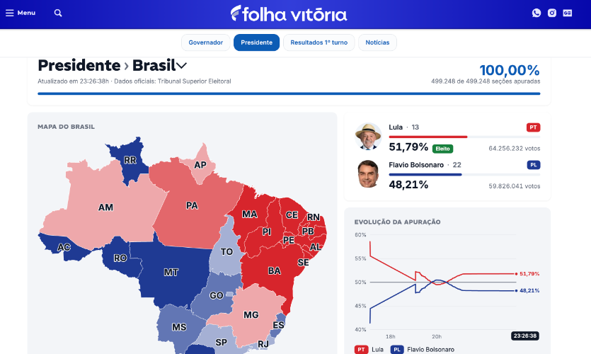
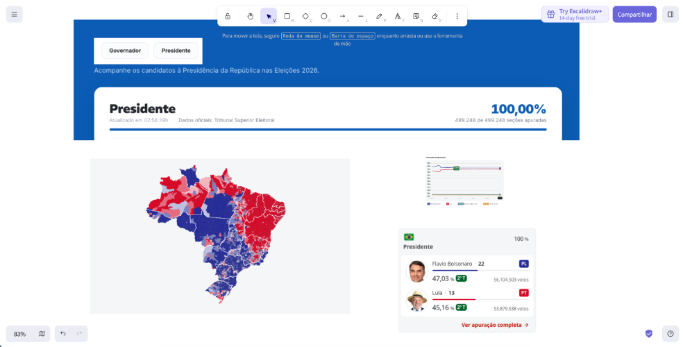
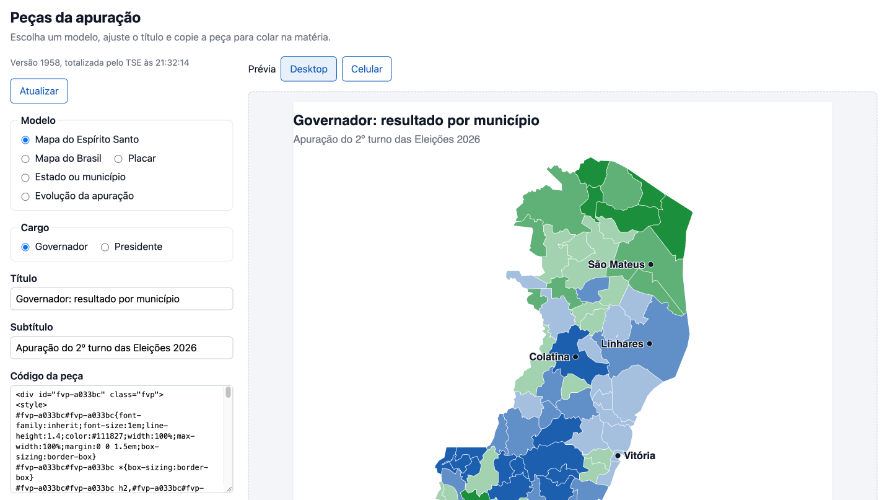

Fala galera, Caio aqui! Nesse post eu quero contar pra vocês sobre esse desafio de criar uma página de apuração das eleições, que fosse resiliente para aguentar o acesso de milhares de leitores do jornal e rápida o suficiente para a cobertura ao vivo conseguir utilizar.



A página entrou no ar na [Folha Vitória](https://www.folhavitoria.com.br/eleicoes-2026/apuracao) e cobriu o 2º turno, no dia 25 de outubro. Do primeiro artefato até a noite da apuração foram 16 dias e cerca de 50 horas de trabalho.

## Escopo do projeto

A redação solicitou uma série de funcionalidades para a página de apuração, como ter um mapa do Brasil e um mapa do estado do Espírito Santo na página, possibilitando ao leitor visualizar a situação da votação em cada parte dos mapas. Além disso, a velocidade era um ponto chave nessa estratégia, pois o ao vivo do jornal precisa ter o dado mais quente possível para conseguir cobrir o evento mais importante da política brasileira.

Eu dobrei a aposta: também quis adicionar um gráfico de histórico da apuração, com uma visualização da timeline da noite a cada atualização do TSE, e um painel interno para a redação conseguir copiar e colar os mapas e gráficos disponíveis no sistema diretamente em matérias e no minuto a minuto.

O dimensionamento saiu do Analytics do próprio site: cerca de 5.500 usuários simultâneos nos últimos 30 minutos observados e 300 mil page views por dia, com margem folgada para o pico entre 17h e 22h de um domingo de apuração.

## Estratégia de infraestrutura

Tudo partiu de um princípio só: **o navegador nunca consulta o TSE**. Quem fala com o TSE é um Cloudflare Worker (o *collector*), que baixa os arquivos oficiais, valida a assinatura e o schema, normaliza e publica um snapshot no R2. O leitor só enxerga arquivos estáticos na CDN.

Isso resolve o problema de escala invertendo a conta: não importa se são mil ou cem mil leitores, o TSE continua recebendo o mesmo número de requisições, as nossas.

A publicação é versionada e imutável. Cada versão vira uma pasta nova de snapshot, e um arquivo minúsculo, o `manifest.json`, aponta para a versão atual. Daí sai a regra de cache, que é a peça mais importante do desenho todo:

- **snapshots** são imutáveis, com `max-age` de um ano. Nunca precisam ser invalidados, porque a URL identifica a versão;
- **o manifest** é o único elemento que precisa estar fresco, com apenas 1 segundo de cache de borda.

No front, Astro serve o shell estático e toda a interatividade vive em uma única ilha React, que consulta o manifest a cada 3 segundos e baixa **só as partes cujo endereço mudou**: o placar nacional, os estados, os municípios do ES e a timeline são arquivos separados. Uma atualização que mexe só nos municípios não faz ninguém baixar o placar de novo.

Os mapas são SVG próprio, gerados a partir da malha do IBGE, com um `path` por UF e por município. Sem Mapbox, sem Leaflet, sem Google Maps: carregados sob demanda, fora do bundle inicial.

### O gargalo das 6 conexões

Aqui veio a parte mais divertida. Um ciclo completo cobre 185 fontes do TSE: totalização de Presidente no Brasil e nas 27 UFs, Governador no ES e os dois cargos em cada um dos 78 municípios capixabas. E uma invocação de Worker só pode ter **6 downloads esperando resposta ao mesmo tempo**. Pior ainda, o cron roda fora do Brasil: à tarde e à noite ele caía na Europa ou na Ásia.

Resultado do ensaio de produção, três dias antes da eleição: 13 segundos só nos downloads das demais abrangências. Os mapas chegavam de 10 a 15 segundos depois da manchete, justamente no começo da apuração.

A primeira solução foi dividir o ciclo em estágios: o *core* (Presidente no Brasil e Governador no ES) baixa e publica primeiro, sozinho, e só depois a coleta do dado granularizado por UFs e municípios era executada. A manchete deixou de esperar a fila inteira, e esse foi um dos grandes "truques" para servir uma boa apuração.

A segunda foi o "fan-out". Num deep dive a três dias da eleição, descobri que um Worker chamado por *service binding* no mesmo data center **divide as mesmas 6 vagas** com quem chamou, ou seja, não adianta nada. Mas um Worker com `placement` em `aws:sa-east-1`, que roda no GRU, tem as 6 vagas dele sozinho. Criei o `elections-downloader`, que só baixa e devolve o corpo, e passei a mandar lotes de até 23 arquivos em paralelo. O download dos 183 arquivos saiu de 13 segundos para 2,4 a 3,9 segundos.

> Dois termos da Cloudflare aqui. Um **service binding** é uma ligação declarada entre dois Workers, que faz um chamar o outro por dentro da plataforma, sem passar pela internet: não tem DNS, não tem TLS e não conta como requisição de rede.
>
> **Placement** é a configuração que diz *onde* o Worker roda. Por padrão ele sobe no data center mais próximo de quem o acionou; com `"placement": { "region": "aws:sa-east-1" }` ele roda sempre em São Paulo. Como um Worker acionado no mesmo data center divide as vagas de conexão de quem chamou, foi essa mudança de lugar, e não a distância até o TSE, que rendeu as vagas extras.

### Resiliência: duas fontes e um plano B

A regra escrita na arquitetura era "último dado válido vale mais que dado incorreto ou vazio". Para honrar isso em uma noite só, duas defesas:

**Uma segunda fonte.** O portal é filiado ao R7, e com isso ganhamos acesso à API interna do conglomerado, que servia as totalizações nacional e estadual. Ela entra por abrangência, só quando tem mais seções totalizadas que o resultado vigente, e **nunca cria um resultado**: apenas troca os números de um resultado que já veio do TSE. Divergiu em candidatos, seções ou eleitorado, a resposta é recusada.

**Um plano B fora da Cloudflare.** Dois dias antes da eleição, a Cloudflare abriu um incidente de Cron Triggers: "delayed, missed and duplicated". No staging, só 44% dos minutos tiveram ciclo. Mexer no gatilho àquela altura era risco novo, então escrevi um comando que roda o *mesmo* collector na minha máquina, via `wrangler dev`, com o bucket e o downloader remotos como bindings. Ele vigia o manifest público e, quando a verificação fica parada por mais de 25 segundos, dispara uma invocação local completa. Publicação condicional, então cron e plano B podiam rodar juntos sem se atrapalhar.

> O **wrangler** é a CLI da Cloudflare para Workers: é com ela que se cria, configura, publica e acompanha os logs de um Worker. O `wrangler dev` roda o Worker na sua máquina, e o truque aqui é que os *bindings* podem continuar apontando para os recursos remotos de verdade — o bucket R2 e o downloader de produção. O código era exatamente o que estava no ar; mudava só o lugar de execução.

## Design e peças para a redação

O design começou num mockup de Excalidraw, montando a tela sobre prints do próprio site e de referências como o g1, antes de escrever qualquer componente. Ele foi o pontapé inicial do projeto, mas no começo serviu apenas para a casca: implementei o layout com o cabeçalho mostrando a totalização, deixei a área do mapa reservada e coloquei o placar de candidatos na lateral direita.



A parte que a redação mais usou, no entanto, foi o gerador de peças: blocos de HTML com o resultado estático, uma foto do momento atual da eleição. O time usou muito essas peças durante toda a apuração, no minuto a minuto do jornal, e seguiu usando ao longo da semana seguinte, mostrando o resultado da eleição em diversas notícias.



Esse recurso é particularmente interessante: a redação poderia muito bem pedir a uma IA que montasse esses blocos de HTML, mas é o sistema entregando a peça pronta e instantaneamente, ao vivo, no meio da apuração, que dá a velocidade de que o time precisava para sair na frente da concorrência. Passada a noite, essas peças foram se mesclando com outras criadas por IA pelas matérias do jornal.

## A noite: esperado x realizado

Os números da página entre 15h e 23h45:

- **2.551.597 requisições**, com pico de ~365/s às 19h45;
- mediana de **9 ms**, p99 de 509 ms e **7 respostas 500** — 0,0003%;
- o collector fez 456 invocações e publicou **868 versões**, de uma só noite.

O detalhe que eu não previ: **a latência melhorou conforme a carga subiu**. Com o bucket vazio, a mediana era de 160 ms; no começo da noite, 10 ms; no pico, 5 ms. O cache de borda de 1 segundo rende mais quanto mais gente lê, porque uma fração maior das consultas cai dentro da janela.

Na latência ponta a ponta, a meta era ficar abaixo de 10 segundos entre o arquivo aparecer no TSE e o dado estar na tela. O medido foi 8,4 s de mediana e 10,8 s de média, sendo que a média ficou pior por causa dos buracos do cron, e o plano B, rodando a noite inteira na minha máquina, foi o que impediu que ela fosse muito pior. A manchete ia ao ar em 1,43 s depois do início do ciclo, contra a meta de 2,5 s.

Essa performance foi fundamental para a cobertura AO VIVO da TV Vitória, que já não tinha conseguido utilizar a página interna no primeiro turno, recorrendo à página de apuração oficial do TSE, perdendo a identidade da marca e a oportunidade de fortalecer o grupo como um todo.


E uma surpresa da noite mudou todo o planejamento da cobertura: o ministro Zanin prorrogou a votação até as 19h, e a apuração, que já tinha começado marcando 0,38% das urnas, ficou congelada nesse número por quase duas horas. O mapa interativo e toda a dinâmica da página foram fundamentais para dar suporte às conversas e aos debates que os âncoras precisaram conduzir nessas 2h a mais.

## O que quebrou

Duas coisas, as duas descobertas com a apuração rodando. E uma premissa que eu levei desde o início do projeto era conseguir publicar correções com o sistema no ar, sem derrubar a coleta e sem precisar pedir que os milhares de leitores dessem um refresh na página (coisa que é impossível).

A primeira foi visual: o mapa do Brasil pintou Goiás com a cor de um partido, enquanto quem liderava lá, com 55,11%, era o outro. O arquivo do TSE entrega os candidatos ordenados por votos, mas traz também um campo `seq`, a sequência fixa do candidato, e o collector reordenava por ele. A tela tratava o primeiro do array como líder, então essa reordenação bastava para pintar a UF com a cor errada. Um detalhe que passou despercebido durante os testes internos.

A segunda foi na coleta de dados: a proteção contra regressão tratava o `idg` do TSE como um número de geração crescente, ou seja, arquivo com `idg` menor era cache velho e ia pro lixo. A premissa é falsa:

```text
21:28:56  idg=4194900  st=498.634
21:29:31  idg=4183935  st=498.662   idg caiu 10.965, com 28 seções a mais
```

Por 21 minutos, o placar nacional ficou preso na segunda fonte, porque todo arquivo do TSE era recusado. Removi a guarda em produção e destravou na primeira invocação.

> Os dois campos vêm dos arquivos de resultado do TSE. O **`idg`** é, nas palavras da própria especificação, o "código identificador da geração do arquivo json" — cada vez que o TSE gera uma nova versão de um arquivo, ela sai com um `idg` novo. Já o **`st`** é a quantidade de seções totalizadas naquela abrangência, o número que alimenta o percentual de urnas apuradas.
>
> A armadilha está em que só um dos dois é monotônico. O `st` nunca volta atrás, porque seção apurada não desapura. O `idg` é um identificador, não uma sequência, a especificação nunca prometeu que ele cresce, isso foi uma dedução minha e a conta chegou no dia da apuração.

Essa foi uma surpresa durante a noite, mas algo do tipo já era esperado: não houve simulado oficial do TSE antes do 2º turno, então foi necessário supor algumas coisas. Os dois consertos subiram **durante** a apuração, sem derrubar a coleta e sem tocar no cron.

## Conclusão

O último princípio da arquitetura era "a infraestrutura deve permanecer simples, observável e **descartável** após a eleição". A eleição terminou e, poucas semanas depois, pude remover toda a estrutura de coleta e o ambiente de staging montados para o projeto, mantendo apenas o front ligado para continuar servindo a página enquanto há acessos nela. Um projeto quase plug-and-play, que mantém o sistema do jornal totalmente agnóstico desse evento bienal do Brasil.

Mais um exemplo de como o desenvolvimento impulsionado por IA está transformando todo o ecossistema de projetos de software: fronteiras que antes jamais seriam alcançáveis hoje são totalmente possíveis, e muito mais rápidas. Tudo depende de como você orquestra os agentes para entregar exatamente o que você quer e precisa.

Espero que tenham gostado, galera!
